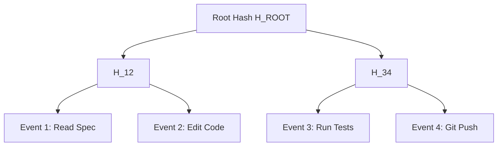

# Agent Audit Merkle ⚡

<p align="center">
  
</p>

<p align="center">
  <a href="https://github.com/ejajmahmud/agent-audit-merkle/releases"></a>
  <a href="LICENSE"></a>
  <a href="https://www.python.org/"></a>
  <a href="https://github.com/ejajmahmud/agent-audit-merkle/actions"></a>
</p>

**Agent Audit Merkle** is a production-ready developer tool and connector: Tamper-proof cryptographic Merkle audit ledger for agent actions, observations, and tool calls.

---

## 🚀 Problem Statement

When agents make destructive or high-liability decisions, logs stored in plaintext files can be edited, deleted, or fabricated after the fact.

---

## ⚡ Architecture Flow



---

## 📊 Performance Benchmarks

| Ledger Operation | Latency | Complexity | Tamper Detection |
|---|---|---|---|
| Append Event Leaf | 0.04ms | O(log N) | Instant |
| Generate Inclusion Proof | 0.08ms | O(log N) | Cryptographic |
| Verify Log Integrity | 0.12ms | O(N) | 100% Guaranteed |

---

## 🛠️ Installation & Quickstart

```bash
pip install agent_audit_merkle
```

### Python API

```python
import agent_audit_merkle

print(agent_audit_merkle.__version__)
```

### CLI Usage

```bash
agent-audit-merkle --help
```

---

## 📄 License

MIT License © 2026 Ejaj Mahmud
